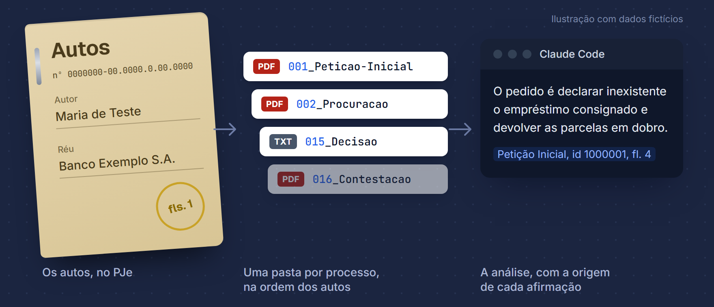
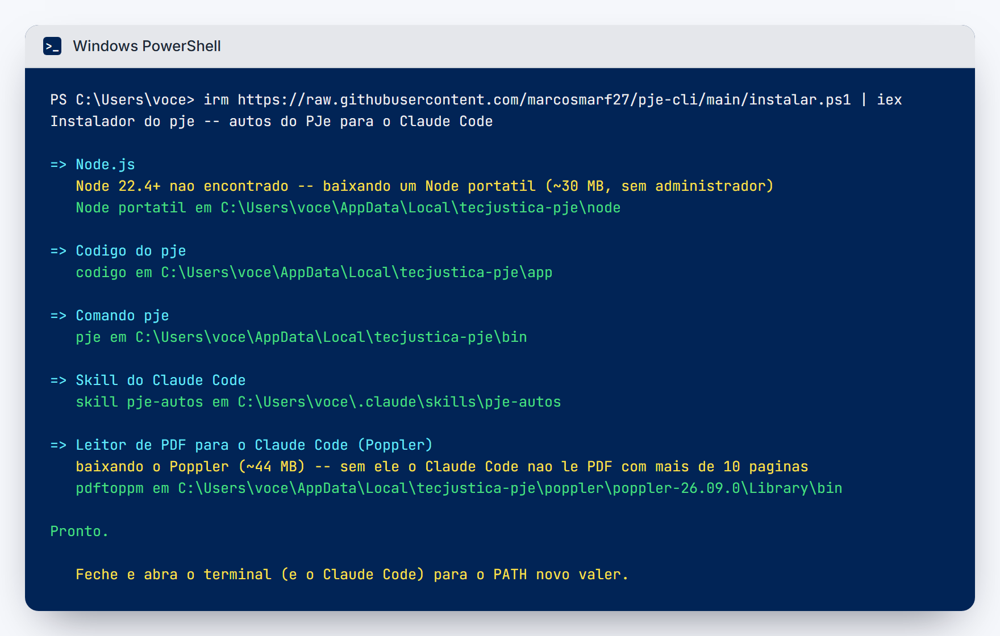
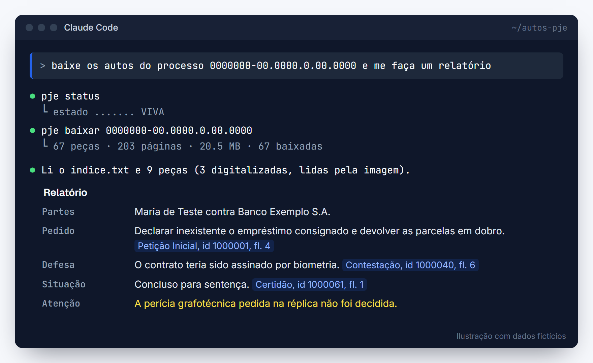
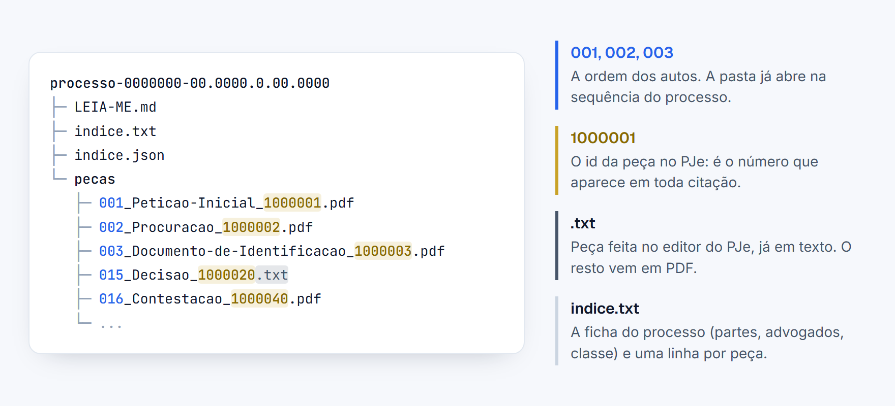

<p align="center">
  
</p>

<h1 align="center">pje</h1>

<p align="center">
  <em>Os autos do PJe no seu computador, prontos para o Claude Code</em>
</p>

<p align="center">
  
  
  
  <a href="LICENSE"></a>
</p>

<p align="center">
  <a href="#instalar">Instalar</a> ·
  <a href="#usar-com-o-claude-code">Usar com o Claude Code</a> ·
  <a href="#o-que-vem-na-pasta">O que vem na pasta</a> ·
  <a href="#seu-login-e-seus-dados">Seu login e seus dados</a> ·
  <a href="#problemas-comuns">Problemas comuns</a>
</p>

O `pje` entra no PJe com **o seu login** e baixa as peças de um processo — ou de uma planilha
de processos — para uma pasta no seu computador, uma peça por arquivo, na ordem dos autos.
Com a skill que vem junto, o **Claude Code** lê essas peças, inclusive as digitalizadas, e
responde dizendo de onde tirou cada afirmação: a peça, o id e a folha.

<p align="center">
  
</p>

## Instalar

### Windows

Abra o **PowerShell** (menu Iniciar → digite *PowerShell*) e cole esta linha:

```powershell
irm https://raw.githubusercontent.com/marcosmarf27/pje-cli/main/instalar.ps1 | iex
```

Não precisa de administrador, e tudo fica dentro do seu perfil. Quando terminar, **feche e abra
o terminal e o Claude Code**.

<p align="center">
  
</p>

<details>
<summary><b>O que o instalador faz, passo a passo</b></summary>

| Passo | O que acontece |
|---|---|
| Node.js | Usa o da máquina. Se não houver a versão 22, baixa um **Node portátil** para a pasta do `pje`, conferido pelo SHA-256 oficial. |
| Código | Baixa este repositório para `%LOCALAPPDATA%\tecjustica-pje\app`. |
| Comando `pje` | Cria o comando e o põe no PATH do seu usuário (nunca no da máquina). |
| Skill | Copia a skill `pje-autos` para `%USERPROFILE%\.claude\skills`, onde o Claude Code a encontra. |
| Leitor de PDF | Instala o **Poppler**, que o Claude Code usa para ler PDF com mais de 10 páginas (versão fixa, SHA-256 conferido). Se a rede bloquear, o resto continua funcionando. |

Rodar a mesma linha de novo **atualiza**: a sessão do PJe e o que você já baixou ficam.

</details>

### WSL ou Linux

```sh
curl -fsSL https://raw.githubusercontent.com/marcosmarf27/pje-cli/main/instalar.sh | sh
```

Instala o `pje` e a skill sem `sudo`, e avisa o que falta e precisa de `sudo`: o Poppler
(`sudo apt install -y poppler-utils`) e, para a janela de login, um **Chrome do Linux** (o do
Windows não serve ao WSL). Testado no Ubuntu do WSL; no macOS ainda não foi testado.

> No Windows, prefira o Windows mesmo. O WSL funciona, mas tem login e sessão próprios.

## Usar com o Claude Code

Abra o Claude Code numa pasta qualquer e peça:

> baixe os autos do processo 0000000-00.0000.0.00.0000 e me faça um relatório

<p align="center">
  
</p>

Na primeira vez, ele pergunta o **endereço do seu PJe** — o que aparece na barra do navegador
até o primeiro pedaço do caminho, como `https://pje.tjce.jus.br/pje1grau` — e abre uma
**janela do Chrome** para você entrar do jeito de sempre. Daí em diante ele segue sozinho, e só
volta a pedir o login quando o PJe encerrar a sessão.

| Peça assim | O que você recebe |
|---|---|
| *faça a linha do tempo deste processo* | Os atos em ordem, com a peça de cada um |
| *quais são os pedidos da inicial, e o que a contestação rebate?* | O confronto ponto a ponto, com as folhas |
| *o réu já foi citado?* | A resposta e a peça que a comprova — ou o aviso de que ela não está nos autos |
| *resuma a sentença e diga se houve recurso* | O dispositivo e o que veio depois |
| *baixe os processos desta planilha* | Todos os processos de um `.xlsx`, uma pasta para cada um |

## O que vem na pasta

Cada processo vira uma pasta dentro de `autos-pje`, na sua pasta de usuário.

<p align="center">
  
</p>

Um salto na numeração (…002, 004…) é uma peça que não veio. O motivo está no fim do
`indice.txt` — quase sempre, peça cancelada no PJe.

## Sem o Claude Code

O `pje` também funciona sozinho, no terminal:

| Comando | O que faz |
|---|---|
| `pje login https://pje.SEUTRIBUNAL.jus.br/pje1grau` | Abre a janela de login. Depois da primeira vez, basta `pje login`. |
| `pje baixar 0000000-00.0000.0.00.0000` | Baixa o processo. De novo no mesmo processo, busca só o que apareceu depois. |
| `pje baixar --lista planilha.xlsx` | Baixa os processos de uma planilha (`.xlsx`, `.ods`, `.xls`) ou de um `.txt` com um número por linha. |
| `pje atualizar` | Atualiza todos os processos já baixados. |
| `pje status` | Diz se a sessão está ativa e o que já foi baixado. |
| `pje logout` | Apaga a sessão e o perfil do Chrome usado pelo `pje`. |

## Seu login e seus dados

- **Você entra no PJe pela janela do Chrome, como sempre.** O `pje` nunca vê a sua senha: ele
  espera o login terminar e guarda a **sessão** — o mesmo cookie que o PJe dá ao navegador.
- **A sessão vale como o seu login.** Ela fica no seu perfil
  (`%LOCALAPPDATA%\tecjustica-pje\sessao.json`, ou `~/.tecjustica-pje/` no Linux). Não
  compartilhe essa pasta; `pje logout` a apaga.
- **Só leitura.** O `pje` não peticiona, não assina, não movimenta e não etiqueta. Ele usa as
  mesmas rotas que a tela do PJe usa, baixa poucas peças por vez e espera quando o servidor pede.
- **Fala só com o PJe.** A análise é feita pelo Claude Code, na sua conta.

## Onde funciona

| Onde | Situação |
|---|---|
| ✅ **TJCE, 1º grau** | Testado: login, download e análise. |
| ➖ **Outros tribunais no PJe 1.x** | Deve funcionar (é o mesmo PJe em que roda a extensão TecJustiça PJe), mas ainda não foi validado. Se testar no seu, [conte aqui](https://github.com/marcosmarf27/pje-cli/issues/new?template=tribunal.yml). |
| ❌ **PJe KZ** (endereço com `pjekz`, como o do TRT2) | Não funciona: não tem as rotas de que o `pje` depende. Ele avisa e para. |
| ✅ **Windows 10 e 11** · ✅ **WSL (Ubuntu)** · ➖ **macOS** | Com Google Chrome (no Windows, o Edge também serve). O macOS não foi testado. |

## Problemas comuns

<details>
<summary><b>"A tela de login voltou depois de você entrar"</b></summary>

O PJe está aberto e logado noutro navegador, e ele não aceita duas sessões do mesmo usuário.
Saia de lá e faça o login de novo na janela que o `pje` abriu.
</details>

<details>
<summary><b>"o navegador não abriu a porta de depuração"</b></summary>

Uma política da máquina bloqueia o controle do Chrome. A alternativa é
`pje login --sessao-atual`, que aproveita a sessão do navegador onde você já está logado e
explica o passo a passo.
</details>

<details>
<summary><b>Uma peça veio com "403"</b></summary>

Quase sempre é peça **cancelada** — o título aparece riscado no PJe. A ausência dela na pasta
está certa.
</details>

<details>
<summary><b>"precisa ser aberta no PJe"</b></summary>

O PJe só monta certas peças depois de abertas. Abra o processo no PJe e rode `pje baixar` de
novo: só o que falta é buscado.
</details>

<details>
<summary><b>"não foi encontrado nesta instância"</b></summary>

O processo é de outro tribunal ou grau que o do login, o dígito está errado, ou é sigiloso sem
acesso para o seu usuário. No TJCE, também acontece com processo que ainda está no e-SAJ.
</details>

<details>
<summary><b>O Claude Code diz "pdftoppm is not installed"</b></summary>

Ele não achou o Poppler, que lê PDF com mais de 10 páginas. Reabra o Claude Code: o PATH novo
só vale para programas abertos depois da instalação. Se continuar, rode a linha de instalação
de novo (no Linux, `sudo apt install -y poppler-utils`). Enquanto isso, a skill transforma as
páginas em imagem e as lê assim.
</details>

<details>
<summary><b>"pje não é reconhecido como comando"</b></summary>

Abra um terminal novo: o PATH muda só nos terminais abertos depois da instalação.
</details>

## Atualizar e desinstalar

- **Atualizar:** rode a mesma linha da instalação. A sessão e o que já foi baixado ficam.
- **Desinstalar no Windows:** `pje logout`; apague as pastas `%LOCALAPPDATA%\tecjustica-pje` e
  `%USERPROFILE%\.claude\skills\pje-autos`; e tire do PATH do usuário as entradas que começam
  por `%LOCALAPPDATA%\tecjustica-pje` (Configurações → *Editar as variáveis de ambiente da sua
  conta*).
- **Desinstalar no Linux:** `pje logout`, e depois
  `rm -rf ~/.local/share/tecjustica-pje ~/.local/bin/pje ~/.claude/skills/pje-autos`.

## Licença e projeto

[AGPL-3.0-or-later](LICENSE). O `pje` faz parte do projeto **TecJustiça**, o mesmo da extensão
[TecJustiça PJe](https://github.com/marcosmarf27/pje-ia) para o Chrome. Este repositório é
gerado a partir do repositório principal do projeto: problemas e sugestões, por
[issue](https://github.com/marcosmarf27/pje-cli/issues/new/choose).
